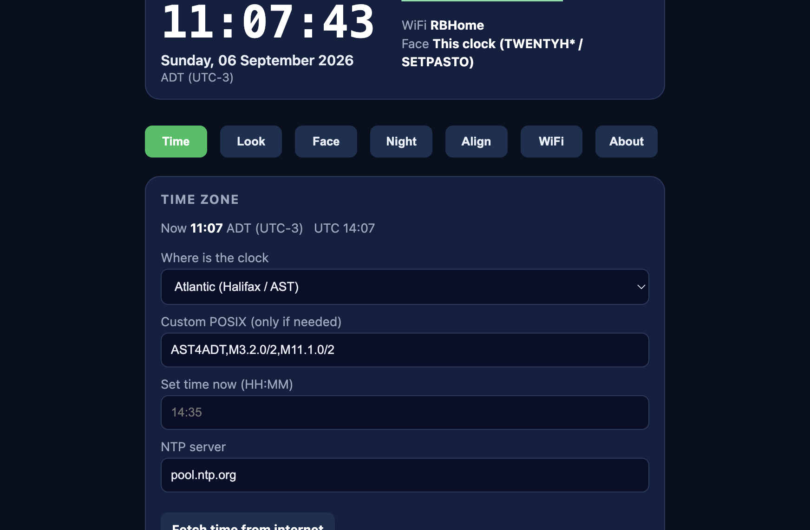
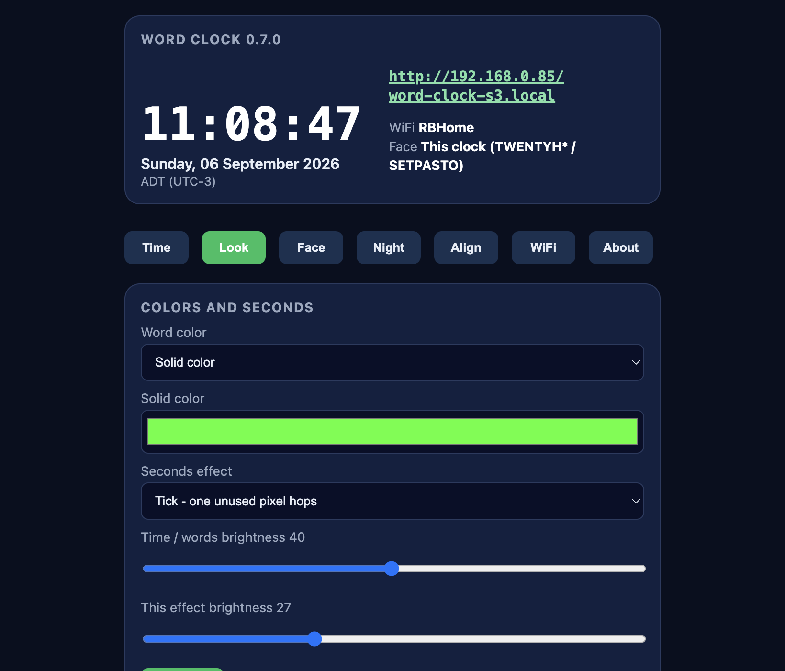
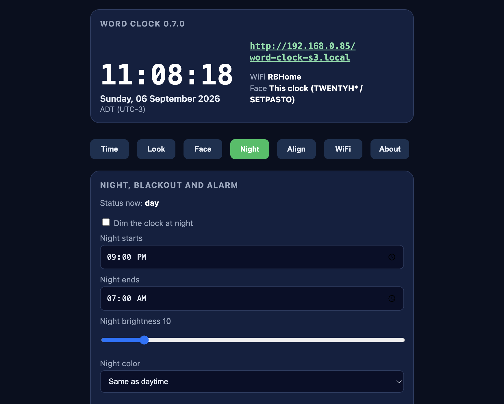
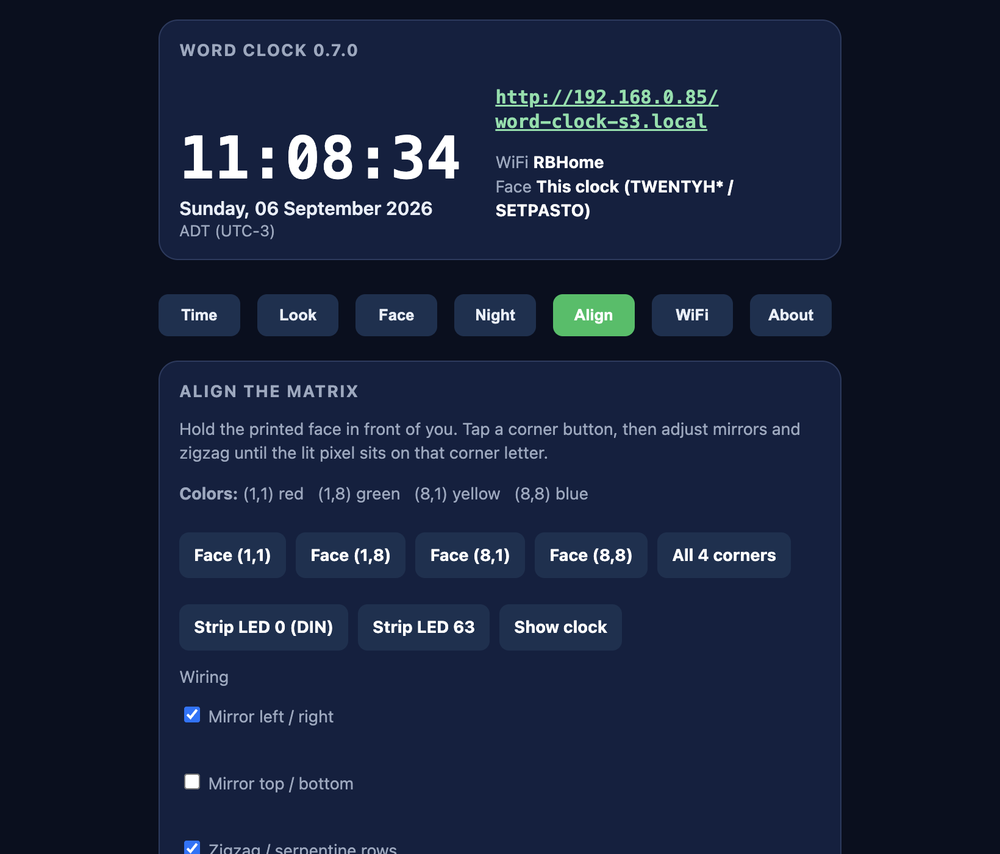
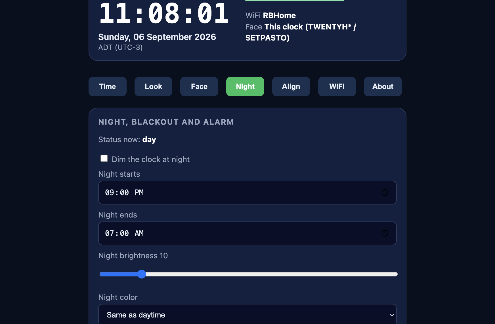
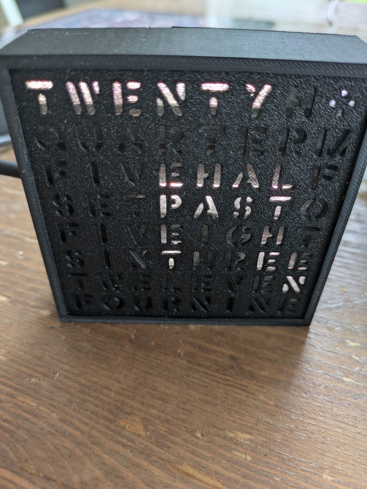

# ESP-WordClock8x8

Firmware for an English **8×8 WS2812 word clock**. Time is synchronized from NTP over Wi-Fi. Configuration is available from a self-hosted web dashboard and from a serial console at 115200 baud.

The primary hardware target is the **M5 Atom S3 Lite** (ESP32-S3). The same firmware also runs on generic **ESP32** and **ESP8266** boards.

This repository publishes the firmware binaries, the documentation, and the images. The C++ source is in the private repository [ESP-WordClock8x8_dev](https://github.com/markusvankempen/ESP-WordClock8x8_dev).

[](https://github.com/markusvankempen/ESP-WordClock8x8_dev)
[](https://platformio.org/)
[](firmware/esp8266/latest.txt)
[](LICENSE)
[](#hardware)
[](#mqtt-and-home-assistant)

<p align="center">
  
</p>

<p align="center"><em>EN 8×8 plate (TWFIFTHA) in the printed case, reading <strong>twenty past eleven</strong> in the default reading shades: minute words red, PAST warm, the hour purple.</em></p>

<p align="center">
  <a href="images/WordClockVideo.mp4"><strong>Watch the clock</strong></a> (12 seconds)
</p>

The earlier reference photo, with the home plate reading TWENTY HALF PAST ONE, is in [3D-printed enclosure](#3d-printed-enclosure).

| | |
|---|---|
| **Repository** | [github.com/markusvankempen/ESP-WordClock8x8](https://github.com/markusvankempen/ESP-WordClock8x8) |
| **Project** | ESP-WordClock8x8 |
| **Author** | Markus Van Kempen |
| **License** | [Apache 2.0](LICENSE) — Copyright (c) 2026 Markus Van Kempen |
| **Collaborators** | None. Sole author. |
| **Dashboard** | `http://wordclock8x8.local` when this is the only clock. If another clock is awake, `http://wordclock8x8-<mac>.local` |
| **Setup access point** | `wordclock8x8-<mac>` (2.4 GHz), for example `wordclock8x8-fbe009` |
| **Firmware** | 0.8.70 |
| **Setup guide** | [SETUP.md](SETUP.md) for the person using the clock, and [SETUP.pdf](SETUP.pdf) to print |

---

## Companion apps

**[Stanza Clock](https://github.com/markusvankempen/chrome-stanzaclock)** is the on-screen twin of this firmware. It replaces the Chrome new tab with the same 8×8 letter plates (Home, ATWENTYD, TWFIFTHA) and the same seconds effects, plus 8×8 and 16×16 faces in English, German, French, Spanish, Italian, Dutch, and Portuguese.

- Extension repo: [github.com/markusvankempen/chrome-stanzaclock](https://github.com/markusvankempen/chrome-stanzaclock)
- Extension, Fire TV app, and Alexa skill sources are in the private repository [ESP-WordClock8x8_dev](https://github.com/markusvankempen/ESP-WordClock8x8_dev).
- Hardware repo (this project): [github.com/markusvankempen/ESP-WordClock8x8](https://github.com/markusvankempen/ESP-WordClock8x8)

Load the Chrome extension unpacked from `chrome-stanzaclock`, or pack with `npm run pack`. Build the Fire TV APK from `firetv-stanzaclock` in Android Studio. Deploy the Alexa skill from `alexa-stanzaclock` (works on Fire TV via Alexa as well as Echo devices).

---

## Contents

1. [Overview](#overview)
2. [Companion apps](#companion-apps)
3. [Features](#features)
4. [Hardware](#hardware)
5. [ESP8266 support](#esp8266-support)
6. [Web dashboard](#web-dashboard)
7. [Header face](#header-face)
8. [First boot](#first-boot)
9. [OTA updates](#ota-updates)
10. [MQTT and Home Assistant](#mqtt-and-home-assistant)
11. [Settings backup](#settings-backup)
12. [Serial console](#serial-console)
13. [3D-printed enclosure](#3d-printed-enclosure)
14. [Build and flash](#build-and-flash)
15. [Troubleshooting](#troubleshooting)
16. [Topics](#topics)
17. [License](#license)

---

## Overview

ESP-WordClock8x8 drives an 8×8 addressable LED matrix behind a stencil letter plate. Minutes are shown as English words (five, ten, quarter, twenty, half, past, to) plus optional 1–4 minute dots. Hours share letters where the plate requires it (TWELVE / ELEVEN, FIVE / EIGHT, PAST / TO, ONE, TWO, SEVEN).

Typical workflow:

1. Flash firmware and complete the one-time Wi-Fi setup.
2. Read the time on the physical face.
3. Open the dashboard for timezone, colours, night schedule, matrix alignment, MQTT, and firmware updates.

Until a time is available (NTP or a previously held clock), the face counts softly through the hour words ONE, TWO, THREE … TWELVE so a missing time lock is visible and the panel does not look unpowered. After the first lock, the last good time is saved and shown across reboots and Wi-Fi drops.

---

## Features

| Area | Capability |
|---|---|
| Time | Software RTC (NTP / hold / set), optional DS3231 on D1/D6, POSIX timezone presets, manual set, live date in the header |
| Appearance | Brightness, hour / solid / rainbow / warm / reading-shades colour modes, own colour per seconds effect, minute dots |
| Startup | One quiet breath, then hour words counting while NTP is fetched |
| Simulator | One live 8×8 face in the dashboard header, plus chips for the settings in use |
| Schedule | Night dimming with optional auto-dim, blackout window, daily alarm with configurable ring duration |
| Face | Home, ATWENTYD, EN 8×8 TWFIFTHA, or a custom 8×8 letter map, with a Face-tab reset |
| Alignment | Mirror X/Y, zigzag, column-major order, corner calibration, all-LEDs test with a brightness slider, wiring presets |
| Network | Setup access point named with the MAC, in-dashboard scan and join, mDNS hostname. The header lists other clocks that are awake |
| Status words | Time words go dark during an action. The first letter is red, the second green, the third blue, and any further letters are white. WIFI while connecting, SAVING while settings are stored, NIGHT, SLEEP, NTP, OFF, or UPDATING (OTA on a plate with no D) |
| Address on the face | When Wi-Fi connects, the face spells IP, then the whole address twice, one group at a time, before the clock starts. `192.168.10.32` shows IP, then 192, 168, TEN, and 32, then those four groups again. 10, 11, 12, 15, and 20 light the one word on the plate. Other groups are digits in red, then green, then blue. A zero is the letter O |
| Updates | GitHub `firmware/esp8266/latest.txt`. On the ESP8266, `ota now` and the daily check reboot into a small updater. The daily check is on at 03:00 unless you change it. `ota 0.8.50` installs that exact version |
| MQTT | Not in the ESP8266 image. The 0.8.46 notes are kept below |
| Backup | Text export and import of settings (passwords excluded) |
| Console | USB serial menu at 115200 baud covering the same settings as the dashboard |

---

## Hardware

| Item | Notes |
|---|---|
| Microcontroller | M5 Atom S3 Lite (default), generic ESP32, or ESP8266 (D1 mini / NodeMCU) |
| Display | 8×8 WS2812 / NeoPixel matrix, 5 V, single data line |
| Power | USB for flash and modest brightness; a dedicated 5 V supply for a full-white matrix |

### M5 Atom S3 Lite

Grove port: red **5 V**, black **GND**, yellow G1, white **G2**.

| Matrix | Atom S3 Lite |
|---|---|
| DIN | **G2** (Grove white), GPIO 2 |
| 5 V | Grove 5 V, or an external 5 V supply |
| GND | Common ground with the Atom |
| Button | GPIO 41 (short press cycles brightness; hold ~1.5 s runs an LED walk) |

Download mode: hold the side **RESET** button for about two seconds until the green LED lights, then release.

### ESP8266 D1 mini

**Recommended DIN is D2 (GPIO 4).** It is not a boot-strap pin, not used by the flash chip, and not the USB serial line, so the firmware can clear the matrix and play the startup breath as soon as power is applied. The onboard blue LED (D4, active low) is held off, and the debug serial that used to blink it is disabled. If the matrix stays on D4, that LED shares the data wire and cannot be turned off separately.

| Matrix | D1 mini |
|---|---|
| DIN | **D2 / GPIO 4** (recommended default) |
| 5 V | 5 V (do not power the matrix from 3.3 V) |
| GND | GND, common with the D1 mini |
| Button | FLASH / GPIO 0 (optional) |
| Extra buttons | D5, D6, D7 to GND (optional, not fitted by default) |
| RTC | D1 SCL, D6 SDA, 3.3 V (optional, off until `rtc on`) |

Also fine: **D1 (GPIO 5)** and D5–D7 (GPIO 14, 12, 13). Avoid these:

| Pin | Why not |
|---|---|
| D4 / GPIO 2 | Boot-strap pin, debug UART, and the onboard LED. Driving it while Wi-Fi starts crashes the chip, and a floating line lights random pixels at power-up. |
| D3 / GPIO 0 | Boot-strap pin. The firmware uses it as the button. |
| D8 / GPIO 15 | Must be low at boot. |
| D0 / GPIO 16 | Poor fit for the fast NeoPixel signal. |
| RX / TX | USB serial. |

Suggested data-line parts, placed at the first LED: a **330 Ω** resistor in series, and a **10 kΩ** resistor from data to GND so the line sits low at power-up. The pull-down is safe on D2, D1, and D5–D7. Do not pull D4 down; the chip needs that pin high to boot. A **470–1000 µF** capacitor across the matrix 5 V and GND helps on USB power.

Change the pin later on the **Align** tab or with `ledpin` / `din` (`d2`, `d1`, `d4`, or a GPIO number). The choice is saved. Compile-time defaults remain `-DWC_LED_PIN=n` and `-DWC_BUTTON_PIN=n`. On ESP8266, GPIO 2 is still parked HIGH after each LED frame so a matrix left on D4 can reboot.

Optional 6×6 tact switches (the kind sold as 6x6x7.3 mm momentary buttons) can call AP mode, the setup portal, home Wi-Fi, Wi-Fi off, power save, or brightness. Wire one leg to a free GPIO and the other to **GND**. The firmware enables the internal pull-up, so the pin sits high until the press. On the Align tab each of the three slots defaults to **Not fitted**, so a board with no extra switches behaves as before. On a D1 mini with DIN on D2, use D5, D6, and D7. Do not use D0, D3, D4, or D8 for these. Serial: `button 1 d5 ap`, `button 1 off`.

A DS3231 real-time clock is optional and stays off until you enable it on the Time tab or with `rtc on`. Wire SCL to **D1**, SDA to **D6**, VCC to **3.3 V**, and GND to GND. NTP or a manual set writes the chip. After that it keeps the time while the D1 is unplugged. D1 and D6 cannot also be option buttons while the RTC is on.

### Default letter plate

Row 0 is the top of the clock:

```text
T W E N T Y H *
Q U A R T E R M
F I V E H A L F
S E T P A S T O
F I V E I G H T
S I X T H R E E
T W E L E V E N
F O U R N I N E
```

### EN 8×8 TWFIFTHA

A common maker-community 8×8 English stencil. Fifteen minutes lights **FIFTEEN**, not QUARTER. Select **EN 8x8 TWFIFTHA** on the Face tab, or serial `plate en08`.

```text
T W F I F T H A
E N V E E N L F
T Y P A S T O T
T W E L V E L E
F O U R N V E N
S I X E I G H T
S E V E N O N E
T H R E E T W O
```

---

## ESP8266 support

The LED, NTP, dashboard, serial, MQTT, and OTA paths are shared. Differences:

| | ESP32-S3 (Atom S3 Lite) | ESP8266 (D1 mini) |
|---|---|---|
| PlatformIO environment | `atoms3lite` | `esp8266` |
| Default DIN | GPIO 2 (Grove G2) | GPIO 4 (D2, recommended) |
| Default button | GPIO 41 | GPIO 0 |
| Flash / OTA | 8 MB, dual OTA slots | 4 MB (`4m1m`) |
| RAM | Sufficient for the full dashboard | Limited. GitHub TLS runs in a small updater stored beside the sketch. The settings backup is plain text |

Wi-Fi is 2.4 GHz on all supported chips.

---

## Web dashboard

Open the `.local` name printed at boot, or the IP address. A clock that was never renamed answers as `http://wordclock8x8.local/` when it is the only one awake. If another word clock is already on the network, this one uses its MAC ending, for example `http://wordclock8x8-fbe009.local/`. The header is a clock-plus-face row. Under the date, chips show the settings in use, then this clock’s address, then **Other word clocks** with a link for each clock that is awake on the same network.

### Time



The Time tab starts with **Software RTC** status (`RTC NTP`, `RTC hold`, `RTC set`, or `RTC waiting`). Timezone presets, NTP server, and a manual clock set follow. After the first NTP lock or a manual set, the last good time is held locally and shown after a reboot or Wi-Fi drop. NTP refreshes about once an hour while the clock is online. The same RTC state is a chip under Device settings.

### Look



Word colour, seconds effect, brightness, and extra-minute dots.

**Word colour** is hour hue, solid, rainbow, warm white, or **reading shades**. Reading shades lights the minute words (FIVE, TEN, QUARTER, TWENTY, HALF), PAST / TO, and the hour in three colours you pick. The defaults are **minutes red (`#FF0000`), PAST / TO `#734812`, hour `#6929FF`**. Every picker applies as soon as you save, and saving a changed colour switches Word colour to Reading shades. Tick **Instead use shades of the solid color** to derive the three from the solid colour. **Reset all colors** returns to those defaults. Extra-minute dots use the minute colour in this mode. Dots start off.

**Effect colour.** Tick, trail, sparkle, and the star blink each have their own colour picker, separate from the minute colours. Defaults: tick `#1D1B1B`, trail blue, sparkle `#B4B4C8`, star blink `#FFDC50`. Trail fades through shades of its colour. **Tick fades** starts off. **When the words change** (Look tab, default fade): the face can jump, play **split-flap** (columns scramble, then lock left to right with a 1-pixel drop, center seam, and top-half shadow so it reads as a falling card), **Tetris** (pieces drop until the 8×8 is full, then the new time), **LED walk** (one pixel chases the strip from DIN, same as the Align walk test), or **fade** (the old time dims out, then the new time fades in). **Test transition** on Look plays it immediately and stays on that tab (about 6 s for split-flap: columns scramble, then lock left to right). Serial: `trans off|flap|tetris|walk|fade` and `trans test`. The seconds effect starts on **tick** at brightness 1. Each effect also has its own brightness slider. Pulse has no colour of its own; it breathes whatever the words are already lit in.

### Night



Night dimming, blackout schedule, and the daily alarm. Time windows may wrap midnight. **Blackout** starts on, from 23:45 to 07:00. Night dimming starts off.

**Dim the clock at night** holds the words at the night brightness for the whole window. **Auto dim** eases from the daytime brightness down to that night brightness at the middle of the window, then back up by morning. The night brightness slider is the dimmest point. Serial: `nauto on`.

### Face

Home, ATWENTYD, EN 8×8 TWFIFTHA, or a custom 8×8 letter map. A new clock starts on **EN 8×8 TWFIFTHA**. **Reset face** restores that plate. The grid here is the letter editor; the live preview stays in the header.

### Align



Corner calibration, wiring options (mirror, zigzag, column-major), and **All LEDs on** to light the whole 8×8. A slider sets the test brightness from 1–100% (default 100%) and the level is remembered; serial `fill 25` does the same. **Show clock** or serial `live` / `cal off` returns to the time.

Action buttons answer with a toast instead of reloading the page, so the tab you are on stays put.

### About



Firmware version, license, settings backup, and OTA install. **0.8.70** reads `firmware/esp8266/latest.txt` on this repo. The page name is `wordclock8x8.local` when this is the only clock, and the MAC name when another clock is awake. In setup the face cycles SETUP, OPEN, PHONE, WIFI, TYPE, PASS, WAIT until a network joins. Factory reset is on this tab and on serial as `factory` or `system factory`. Status words use red, green, blue, then white. When Wi-Fi connects, the face spells IP, then the whole address twice, one group at a time. A group that is one word, such as 10, lights TEN. The header lists other clocks that are awake. Settings export is `key=value` text, not JSON. On the ESP8266, `ota now` shuts the page down and reboots into a small updater that has enough RAM for GitHub. If that file is not a newer version, the updater writes the current firmware back. The same updater runs once a day at a local time, **03:00** unless you change it, from the About tab or with `ota auto 03:00`. `ota auto off` stops that daily check. A boot at any other hour does not check. `ota 0.8.50` installs that exact image, older or newer, from `firmware/esp8266/v8.50/firmware.bin`. The About tab has the same **Install version** field. Until you rename the clock, a lone clock answers as `wordclock8x8.local`. A second clock uses the MAC name, for example `wordclock8x8-fbe009`, so the two do not share a name. The setup network always uses that MAC name, even if the page name is `wordclock8x8.local`. If the saved network is missing, the face cycles WIFI, LOST, WAIT, TRY, then shows the saved time. In power save the radio turns off then as well, instead of waiting out the dashboard window. MQTT is not in this image.

---

## Header face

The dashboard header is the only live simulator. It matches the LEDs on the device: letter plate, colours, seconds animations, minute dots, night dimming, blackout, alarm, and alignment previews. Chips under the date jump to the matching tab. This clock’s IP and `.local` name sit under the chips. **Other word clocks** is filled after the page loads, from the clocks advertising themselves on the LAN. A clock in power save does not appear while its radio is off.

The Face tab grid is the letter plate editor, not a second live preview. **Reset face** restores the EN 8×8 plate.

| Item | Detail |
|---|---|
| Where | Header only |
| Source | `GET /api/face` about five times per second |
| Settings | `GET /api/time` includes `source`, colour, effect, brightness, plate, night, and alarm |
| Payload | `letters` (64 characters), `rgb` (64 × RRGGBB), `words` (spoken time), `mode`, `fx` |
| Animations | Star blink, pulse, trail, tick, sparkle. Each has its own colour, primary by default (Look tab, or `fxcolor <rrggbb>` / `fxcolor default` on serial) |
| Reading shades | Colour mode **Reading shades** lights minute words, PAST / TO and the hour in separate shades of the solid colour, or in three colours you pick (Look tab, `color shades`, `shade auto`, `shade min\|pt\|hour <rrggbb>`) |
| Waiting for time | Hour words ONE … TWELVE fade in and out, about 1.5 s each, dim blue before Wi-Fi and dim amber after. A plate with no hour words falls back to a faint centre glow |

Example:

```text
GET /api/face
{"ok":true,"mode":"day","fx":"star","words":"TWENTY PAST ONE +2","letters":"TWENTYH*...","rgb":"FFD24A..."}
```

Use the header face to confirm wiring, colour, and effect settings without standing in front of the enclosure.

---

## First boot

1. Flash a binary from [`firmware/esp8266/`](firmware/esp8266/latest/firmware.bin), or build from the private source repository.
2. Join the setup access point (2.4 GHz). Its name is `wordclock8x8` plus the last three MAC bytes, for example `wordclock8x8-fbe009`.
3. Open `http://192.168.4.1` and enter the home network.
4. Open `http://wordclock8x8.local/` when this is the only clock, or the MAC name when another clock is already awake. The number address works either way. The face cycles SETUP, OPEN, PHONE, WIFI, TYPE, PASS, and WAIT until the network joins.
5. At power-up the centre of the matrix takes one quiet breath, then the hour words count ONE, TWO, THREE … until NTP (or a held clock) is ready. When the address arrives, the face spells IP, then the whole address twice, one group at a time, then shows the time. On a D1 mini wired to D4 this first breath is skipped, because that pin must stay quiet while Wi-Fi starts.

Default timezone is Atlantic Time with daylight saving (`AST4ADT`). Change it on the Time tab or with `tzlist` / `tz ast` on the serial console.

---

## Wi-Fi down, disconnect, and AP mode

The clock face never depends on Wi-Fi. Time comes from a software clock that keeps counting, and the last good time is saved to flash, so the matrix keeps showing the right words when the router is off, the link drops, or Wi-Fi is switched off.

- **Connecting:** the face cycles WIFI, LOST, WAIT, and TRY. After about 20 seconds the time returns, even if the network is still missing, and the hint comes back for a few seconds now and then. The radio keeps trying.
- **Link drops:** with a saved network the clock keeps running and retries every 30 s. It does not open the setup AP right away. If the link stays down for 10 minutes, the setup AP appears so you can fix the network. Its name ends with the last three MAC bytes. NTP resumes by itself when the link returns, and the clock then corrects any drift.
- **Power save:** Wi-Fi tab → *Wi-Fi off between time checks*, or serial `powersave on`. After the clock has a saved network and the time, the radio switches off. Without a DS3231 it wakes on a saved interval, **once a day (24 hours) by default**. Set another interval with `powersave 12` (1–168 hours) or the hours field on the Wi-Fi tab. If that wake cannot reach the time server it tries again in 15 minutes. With the DS3231 turned on and found, the chip keeps the time, so Wi-Fi still wakes **once a day**. After you plug it in, Wi-Fi stays up for 5 minutes once the saved network has joined, so the dashboard can be opened. If the network never appears and a time is already saved, the radio turns off after 20 seconds and the face shows that time. With no saved time it waits 90 seconds, then sleeps and tries again later. `powersave off` leaves Wi-Fi connected. Serial `ota now` checks GitHub immediately.
- **Disconnect (offline mode):** Wi-Fi tab → *Disconnect Wi-Fi*, or serial `wifi off`. The radio stays off and the saved network is kept. Get back with serial `wifi on`.
- **AP mode:** Wi-Fi tab → *Switch to AP mode*, serial `wifi ap`, or hold the button for 6 seconds. Unplug and plug the clock back in 3 times within 3 minutes to open the same setup network. The face cycles SETUP, OPEN, PHONE, WIFI, TYPE, PASS, and WAIT until a network joins. The network is named `wordclock8x8` plus the last three MAC bytes, and the dashboard is at `http://192.168.4.1/`. You can set the time by hand, change the look, scan and join a network, or go back with *Reconnect to home Wi-Fi*. No NTP or MQTT in this mode, so the open dashboard sends your phone or computer clock to the matrix (on load, then every 10 minutes) to keep the time and date right.
- Offline and AP mode survive a reboot, so the clock stays as you left it. Joining a network from the dashboard returns to normal mode; if the join fails, AP mode comes back.

| Mode | Radio | Dashboard | Clock face |
|---|---|---|---|
| Home (default) | Saved network | `http://<name>.local/` | Runs, NTP sync |
| Power save | Off. Time check once a day by default (1–168 h without an RTC; daily with the DS3231) | during a wake, and for 5 minutes after a network joins | Runs on held time. If Wi-Fi is missing, the time returns after 20 seconds |
| Offline | Off | none | Runs on held time |
| AP | Own AP | `http://192.168.4.1/` | Runs; time kept by the browser clock |

---

## OTA updates

After the device is on the LAN:

- **Browser file:** About tab → select a `.bin` → Install firmware.
- **Browser URL:** About tab → Firmware URL → **Save URL** (kept across reboot). **Update from URL** checks immediately. The default is this repo's `firmware/esp8266/latest.txt`. The clock compares that text with the running version and, when GitHub is newer, downloads `latest/firmware.bin`.
- **Daily check:** on by default at **03:00** local time. Change the time on the About tab or with `ota auto 03:00`. `ota auto off` stops it. The check does not run on every boot. If the clock is off at that time, it waits until the next day.
- **PlatformIO:** `pio run -e esp8266 -t upload --upload-port wordclock8x8-fbe009.local` (use the name printed at boot).
- **Serial:** `ota now` runs that check immediately. On the ESP8266 it reboots into a small updater, because the clock itself does not have enough free RAM for the GitHub connection. `ota auto` shows the daily check, which is on at 03:00 unless changed with `ota auto 03:00` or turned off with `ota auto off`. `ota 0.8.50` (also `update 0.8.50`) installs that version even when it is older. `ota` still reports whether ArduinoOTA is listening.

---

## MQTT and Home Assistant

Firmware **0.8.70** does not include MQTT. The notes below describe the 0.8.46 backup.

Enable MQTT on the Wi-Fi tab or from the serial console:

```text
mqtt on
mqtt host 192.168.0.10
mqtt port 1883
mqtt user home
mqtt pass secret
mqtt prefix wordclock
```

| Topic | Direction | Payload |
|---|---|---|
| `{prefix}/state` | Device → broker (retained) | JSON: `time`, `time_src`, `mode`, `bright`, `color`, `night`, `blackout`, `alarm` |
| `{prefix}/cmd` | Broker → device | JSON or text (`bright 24`, `night off`, `alarm stop`, `{"color":"warm"}`) |

Optional Home Assistant discovery publishes `homeassistant/sensor/<hostname>/state/config`.

---

## Settings backup

- About tab: export or import a text file of `key=value` lines (`wordclock-settings.txt`)
- `GET /api/settings` and `POST /api/settings`
- Serial: `export`, or `import bright=20` for one line. Paste the full file on the About tab.

Wi-Fi passwords are not included.

---

## Serial console

115200 baud. Type `help` for a short topic list, `help <topic>` for one section, or `help all` for every command. Topics: `time`, `color`, `look`, `night`, `face`, `align`, `wifi`, `mqtt`, `system`.

| Command | Function |
|---|---|
| `status` | Full status, including shades and effect colours |
| `fetch` / `ntp <host>` | NTP sync |
| `set HH:MM` | Set the clock (held until NTP) |
| `tz <id>` / `tzlist` | Timezone |
| `color <mode>` | `hour`, `solid`, `rainbow`, `warm`, `shades` |
| `rgb <r> <g> <b>` | Solid colour, 0–255 each |
| `shade default` / `shade auto` | Minute red, PAST/TO `#734812`, hour `#6929FF` / shades of the solid colour |
| `tickfade on\|off` | Tick dot fades between seconds |
| `flap on\|off` / `trans off\|flap\|tetris\|walk\|fade` | Phrase change: off, row flap, Tetris, LED walk, or fade |
| `trans test` | Play the current phrase transition now |
| `shade min\|pt\|hour <rrggbb>` | Colour for minute words, PAST / TO, or the hour |
| `effect <name>` | `off`, `star`, `pulse`, `trail`, `tick`, `sparkle` |
| `fxcolor <rrggbb\|default>` | Own colour for the current effect (not pulse or off) |
| `fxbright <1-80>` / `mdots on\|off` | Effect brightness, extra-minute dots |
| `night` / `sleep` / `alarm` / `alen` | Schedule |
| `letters` / `rowset` / `plate` / `facereset` | Face |
| `ledpin` / `din` | NeoPixel DIN. D1 mini: `d2` (default), `d1`, or a GPIO number |
| `button` | Optional tact switch. `button 1 d5 ap`, `button 1 off`. Slots default to not fitted |
| `rtc on\|off` | Optional DS3231. SCL D1, SDA D6. Off until enabled |
| `align` / `cal` / `flipx` / `zigzag` | Wiring |
| `mqtt` / `export` / `import` / `ota` | Integration and backup |
| `hostname <name>` | Dashboard name. `wordclock8x8` is the automatic name: short when this clock is alone, MAC when another clock is awake. The setup AP always uses the MAC name |
| `factory` | Erase settings and Wi-Fi, then open the setup network. `system factory` does the same. The firmware stays |
| `ota` / `ota now` / `ota auto` / `ota 0.8.50` | ArduinoOTA status, check GitHub now, daily check at 03:00 (`ota auto on`, `ota auto off`, `ota auto 03:00`), or install that version |
| `wifi` | Show Wi-Fi mode. `wifi off` disconnects, `wifi ap` starts own AP + dashboard, `wifi on` reconnects, `wifi portal` opens the setup portal |
| `powersave on\|off` | Radio off after setup. Without an RTC the wake defaults to once a day |
| `powersave <hours>` | Without an RTC, wake every 1–168 hours. `powersave 24` is once a day |
| `scan` / `join` | Find and join a network |

---

## 3D-printed enclosure

<p align="center">
  
</p>

<p align="center"><em>Earlier build photo. The home plate reads TWENTY HALF PAST ONE. The desk photo at the top is the EN 8×8 plate.</em></p>

This repository does not include STL files. Search Printables, Thingiverse, MakerWorld, or Cults3D for **word clock 8x8**, **word clock stencil**, or **word clock enclosure**.

After assembly, use the Align tab so the lit corners match the printed letters.

| Site | Search |
|---|---|
| [Printables](https://www.printables.com/search/models?q=word%20clock) | word clock 8x8 |
| [Thingiverse](https://www.thingiverse.com/search?q=word%20clock) | word clock |
| [MakerWorld](https://makerworld.com/en/search/models?keyword=word%20clock) | word clock |
| [Cults3D](https://cults3d.com/en/search?q=word+clock) | word clock |

---

## Build and flash

Prebuilt ESP8266 images are in [`firmware/esp8266/`](firmware/esp8266/). `latest.txt` names the current version, and `latest/firmware.bin` is that image. Older images stay in version folders such as `v8.65/` and `v8.50/`, which `ota 0.8.65` and `ota 0.8.50` install.

The C++ sources, `platformio.ini`, and the upload script are in [ESP-WordClock8x8_dev](https://github.com/markusvankempen/ESP-WordClock8x8_dev). Serial logs are 115200 baud.

---

## Troubleshooting

| Symptom | Action |
|---|---|
| Matrix is dark | `fill` on serial; check 5 V, GND, and the DIN GPIO. On a D1 mini the default is D2 (`ledpin d2`) |
| Random LEDs at power-up | Data line is floating. Use D2 with a 10 kΩ pull-down to GND. D4 cannot be pulled down |
| D1 mini reboots or the dashboard never comes up | DIN is on D4. Move it to D2 and run `ledpin d2` |
| Incorrect colours | `order rgb` |
| Words in the wrong place | Align tab or `align mirrorxz` |
| Time offset by hours | `tzlist` then `tz ast` (or the local zone) |
| ONE, TWO, THREE keeps cycling | No held time and NTP is not locked; confirm Wi-Fi and run `fetch` or `set HH:MM` |
| ESP8266 dashboard instability | Heap is limited; use serial for large imports |

---

## Topics

Suggested GitHub topics so the repository can be found:

`esp32` `esp32-s3` `esp8266` `arduino` `platformio` `word-clock` `wordclock` `led-matrix` `ws2812` `neopixel` `8x8` `m5stack` `m5-atom` `atom-s3` `iot` `ntp` `mqtt` `home-assistant` `homeassistant` `ota` `wifi` `3d-printing` `diy-clock` `firmware` `embedded` `smart-home` `wled-alternative` `desk-clock` `wall-clock`

When the repository is on GitHub:

```bash
gh repo edit --add-topic esp32,esp32-s3,esp8266,arduino,platformio,word-clock,wordclock,led-matrix,ws2812,neopixel,8x8,m5stack,m5-atom,atom-s3,iot,ntp,mqtt,home-assistant,ota,3d-printing,diy-clock,firmware,embedded,smart-home
```

---

## License

[Apache License 2.0](LICENSE). Copyright (c) 2026 Markus Van Kempen.

This project has a **single author** and **no collaborators**. See [`NOTICE`](NOTICE).
