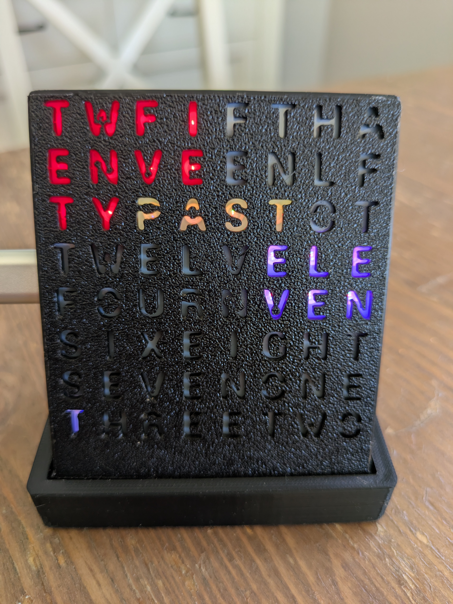

# Word clock setup

A short guide for the finished clock. You do not need to install any software. The full builder notes are in [README.md](README.md). Firmware **0.8.70**.

*The face above is reading **twenty past eleven**. Minute words are red, PAST is warm, and the hour is purple.*

The clock uses a 2.4 GHz Wi-Fi network. A 5 GHz-only network will not appear in its list.

---

## 1. Plug it in

Use the USB cable and a normal USB charger. The middle of the face takes one quiet breath, then the hour words count **ONE**, **TWO**, **THREE** until the clock has the time.

From 11:45 pm to 7:00 am the face is dark on purpose. That blackout is already turned on. Change the hours on the **Night** tab once the page is open.

## 2. Join the clock’s own Wi-Fi

On a new clock, or after the home network has been missing for about 10 minutes, the clock opens its own network.

1. On your phone, open Wi-Fi and choose the network named **wordclock8x8-** followed by six letters or numbers. An example is `wordclock8x8-fbe009`. Every clock has its own ending. There is no password.
2. If the phone asks you to sign in to the network, allow it. Otherwise open a browser and go to **http://192.168.4.1**
3. Pick your home Wi-Fi, enter its password, and save.

The clock then leaves that setup network and joins your home network. Put your phone back on the home Wi-Fi as well.

If the clock has a button, holding it for about 6 seconds opens this setup network again. You can also unplug the clock and plug it back in **three times**, without leaving it running for 3 minutes in between. The face cycles **SETUP**, **OPEN**, **PHONE**, **WIFI**, **TYPE**, **PASS**, and **WAIT** until the clock has joined a network. The setup network comes back. If the home network is missing later, the face cycles **WIFI**, **LOST**, **WAIT**, **TRY**, then shows the time again.

## 3. Open the clock

When the home network connects, the face spells **IP**, then the **whole address** twice, one group at a time, and then starts the clock. `192.168.10.32` is IP, then 192, 168, TEN, 32, and that number sequence again. A group that is already one word, such as 10, 11, 12, or 20, lights that word. Other groups are digits: red, then green, then blue. A zero is the letter O.

| Address ending | What the face spells |
|---|---|
| `.74` | SEVEN in red, FOUR in green |
| `.123` | ONE in red, TWO in green, THREE in blue |
| a `0` in the number | the letter **O** |

The setup page also shows the full address. Either of these opens the clock:

- `http://wordclock8x8.local` — when this is the only word clock on the network
- `http://wordclock8x8-fbe009.local` — when another clock is already awake. Use the same ending as the setup network name
- `http://192.168.0.74` — use the address the page showed, with your own numbers

The top of the page is a live copy of the face. Under the date you will see this clock’s address, then **Other word clocks** if another clock on the same network is awake. A clock that has turned its radio off for the night does not appear in that list.

## 4. Set your time zone

A new clock starts on **Atlantic Time**. On the **Time** tab, choose your zone and save. The words on the face follow that zone.

The clock gets the time from the internet about once an hour. After the first successful set, it keeps that time through a power cut and a Wi-Fi outage. If the hour words keep counting **ONE**, **TWO**, **THREE**, the clock does not have a time yet. Check the Wi-Fi password, or set the time by hand on the **Time** tab.

## 5. How to read the face

The plate in the photo is the **EN 8×8** face. It shows the time in five-minute steps:

- on the hour, only the hour (**THREE**, **ELEVEN**, …)
- **FIVE**, **TEN**, **FIFTEEN**, **TWENTY**, or **TWENTY FIVE** past or to the hour
- **HALF PAST** for 30 minutes

Fifteen minutes is the word **FIFTEEN**, not QUARTER. With the extra-minute dots left off, 11:23 still reads as twenty past eleven. Turn the dots on from the **Look** tab to show the extra one to four minutes.

## 6. Colours, brightness, and night

Open the page and use the tabs:

| Tab | What you change |
|---|---|
| **Look** | Colour, brightness, the seconds tick, and how the words change |
| **Night** | Dimmer hours, the blackout window, and a daily alarm |
| **Face** | Leave this on **EN 8×8 TWFIFTHA** unless you built a different letter plate |
| **About** | Firmware version, a settings backup, and updates |

**Reading shades** is the look in the photo: minute words red, PAST or TO warm brown, the hour purple. **Reset all colors** on the Look tab returns to that.

While the clock is saving a change, the time words go dark and the face spells **SAVING**. The first letter is red, the second green, the third blue, and any letters after that are white. The same colours are used for **WIFI**, **NIGHT**, **SLEEP**, and **UPDATING**.

## 7. Updates

Leave the clock powered overnight. Once a day, at **3:00 am** local time, it checks for a newer version and installs it. The face spells **UPDATING** while that happens. Leave it plugged in until the time comes back.

You can turn that check off, or pick another time, on the **About** tab under **Check GitHub every day at**.

## 8. A new router or a new house

The clock keeps trying the saved network. After about 10 minutes without it, the setup network from step 2 comes back. Join `wordclock8x8-……`, open **http://192.168.4.1**, and enter the new Wi-Fi.

**Factory reset** is on the About tab, or type `factory` or `system factory` on the serial console at 115200 baud. It erases Wi-Fi and every saved setting, keeps the firmware, and opens the setup network. The face spells **RESET**, then **SETUP**.

The setup network name stays tied to the clock even if you rename the page. Typing `wordclock8x8` on the dashboard returns the page to the automatic name: `wordclock8x8.local` when this clock is alone, and the MAC name when another clock is awake.

## 9. If it does not look right

| What you see | What to do |
|---|---|
| Face is dark in the evening or early morning | Blackout is on from 11:45 pm to 7:00 am. Change it on the **Night** tab. |
| **WIFI**, then the old time | The home network was not found. The clock shows the saved time after about 20 seconds and keeps trying. |
| Hour words counting ONE, TWO, THREE | No time yet. Confirm Wi-Fi on the **Time** tab, or set the clock by hand. |
| Time is off by hours | The zone is still Atlantic Time. Choose yours on the **Time** tab. |
| Words lit in the wrong places | On the **Align** tab, match the lit corners to the printed letters. |
| The page will not open | Rejoin the home Wi-Fi, then try the `.local` name and the number address. |

Wiring, flashing, and the serial menu are in [README.md](README.md).

---

ESP-WordClock8x8 · firmware 0.8.70 · [github.com/markusvankempen/ESP-WordClock8x8](https://github.com/markusvankempen/ESP-WordClock8x8)
